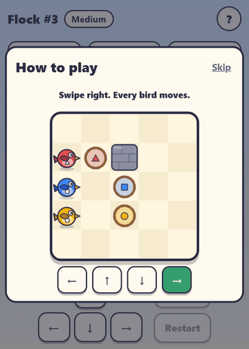

# Flock

A daily puzzle for Reddit. One swipe moves three birds at once. Put each bird on the nest of its own color in as few moves as you can. Built with Devvit Web for Reddit's Game of the Day Hackathon 2026.

  

[Watch the demo as MP4](docs/flock-demo.mp4) (15 seconds).

## How it plays

- **One swipe moves every bird** one cell in that direction.
- **Walls, the board edge and other birds stop a bird.** The others keep flying.
- **Get each bird onto its own nest** in as few moves as you can.
- **Par** is the fewest moves possible, found by a solver. Match it for a Perfect.
- **Twist days:** the yellow bird flies the opposite way.
- **Golden Feather:** most days have a feather on the board. Get every bird home *and* land a bird on the feather for a 👑 Crown. Crown par is set by the solver and is always 1 to 4 moves above par, so players choose between the shortest route and the Crown.

Everyone in a community gets the same puzzle each day. New players get a two-swipe tutorial the first time they open it.

## Commands

- `npm run test:unit` runs the rules engine tests
- `npm run type-check` checks types
- `npm run lint` runs ESLint
- `npm run build` builds client and server into `dist/`
- `npm run login` then `npm run dev` starts a Reddit playtest
- `node --experimental-strip-types --no-warnings=ExperimentalWarning scripts/level-report.ts 28` prints par and difficulty for the first 28 puzzles
- `node --experimental-strip-types --no-warnings=ExperimentalWarning scripts/depth-test.ts` measures puzzle depth on random boards
- `node --experimental-strip-types --no-warnings=ExperimentalWarning scripts/preview-server.ts` serves the built client with a mock API at http://localhost:4173/game.html?day=3 (days 5 and 7 are twist days)

## Layout

- `src/shared/engine/` pure rules, solver, generator, daily plan, tutorial board, share text
- `src/server/` Hono routes, Redis results, best scores and streaks, daily post
- `src/client/` React UI, played inline in the post (`game.tsx`)
- `docs/` demo GIF and MP4
